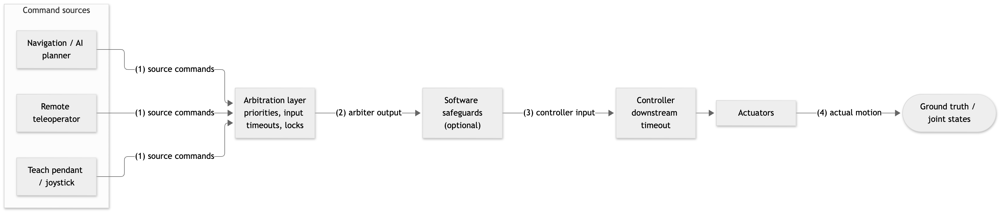

# Authority Handover and Link-Loss Fail-Safe Behavior

|ID          |
|------------|
|RSTG-CMDA-04|

## Summary

Many robots accept motion commands from several command sources, such as a navigation stack, an AI planner, a remote teleoperator, a teach pendant, and a fleet management system. An arbitration layer, such as a command multiplexer or a mode switch, decides which source is in control at any moment.

Terms such as *command source*, *transition*, *expected behavior*, *enabling control*, *liveness check*, and *downstream timeout* are defined in the [3.8.0 Overview](00-Overview.md).

Where arbitration sits, and the points (1)-(4) at which to collect evidence:



This test evaluates what the robot does at each transition. At every transition, the robot should end up where the expected behavior says: under the control of the intended source, or in its safe state. It should never move under commands from a source that was not given control.

A common failure is implicit fallback. A priority-based arbiter forwards commands from the highest-priority source that is still sending them. When the link to the operator is lost, it forwards the next source's commands instead, such as the navigation goal the operator was overriding. Whether a fallback is acceptable depends on the expected behavior. The finding is a transition that the expected behavior does not allow, or a robot that does not reach its safe state within its stopping requirement.

> [!CAUTION]
> **KINETIC RISK:** Exploitation produces unintended physical robot motion. Follow Section 2.3 (Rules of Engagement and Kinetic Containment) before conducting active tests on hardware.

> [!NOTE]
> **Important Note:** This test covers transitions between command sources. Arbitration is examined here only during takeover, link loss, and recovery; general handling of conflicting commands belongs to RSTG-CMDA-03. Security of the teleoperation channel itself and lower-privilege sources issuing higher-privilege actions are out of scope for this test case. Loss of the operator link and the arbiter's response to it are covered here, including when no other source is active (test 2). Failure inside a single source's bridge, such as an AI tool bridge, is covered in RSTG-EMAI-05.

## Test Objectives

- Identify every command source, the arbitration layer between them, and the expected behavior for each transition.
- Verify that losing the link to the source in control brings the robot to its safe state within the stopping requirement, or to another state the expected behavior explicitly allows.
- Verify that control does not pass to another source without an explicit handover, and that the receiving source does not resume a task set before the handover without confirmation, where the expected behavior requires them.
- Verify that releasing an enabling control stops motion.
- Verify that no other source can command motion while a local operator holds control (single point of control), where the target requires it.
- Identify arbiter configuration that disables liveness checks, such as zero timeouts on inputs or locks.

## Hardware & Environment Requirements

- **Physical Components:** Not required. Optional: the robot with the operator input devices used in deployment, such as a joystick, teach pendant, or tablet, and a hardware E-stop.
- **Testing Tools:** [ROS 2 CLI](https://docs.ros.org/en/jazzy/Concepts/Basic/About-Command-Line-Tools.html) (`ros2 topic`, `ros2 node`, `ros2 param`, `ros2 bag`); a way to interrupt the operator link, such as stopping the operator's publisher or dropping traffic with Linux [`tc netem`](https://man7.org/linux/man-pages/man8/tc-netem.8.html); logs from the arbiter and each source with timestamps.
- **Simulation / Software:** ROS 2 with [Gazebo](https://gazebosim.org/docs/harmonic/getstarted/); the target's arbitration mechanism (for example, [twist_mux](https://github.com/ros-teleop/twist_mux) on ROS 2); at least two command sources, such as a navigation stack and a teleoperation node.

## How to Test

### Safe Verification (Indicators of Vulnerability):

1. **Record the expected behavior before testing.** Take it from the integrator's specification or risk assessment where one exists. For each source in control and each event, record the expected result. For example:

   | Source in control | Event | Expected result (example) |
   |---|---|---|
   | Teleoperator | Teleoperator link lost | Stop and hold; autonomy does not resume until re-enabled |
   | Teleoperator | Enabling control released | Stop |
   | Autonomy | Operator takes control | Only operator commands are executed |
   | Teleoperator | Operator hands back control | Autonomy resumes only after the task is confirmed |
   | Local pendant (manual mode) | A remote source sends motion commands | Commands are ignored |

   Also define the target's **safe state** and **stopping requirement**. If the target has no expected behavior defined for a transition, record that as a weakness.
2. **Collect evidence at each point, with timestamps on a common clock** (use simulation time where available): the commands each source sent (1), the arbiter's output (2), the final controller input (3), and actual motion (4) from simulator ground-truth pose, joint states, or odometry computed from feedback. Record the arbiter's status if it publishes one.

   ```bash
   ros2 bag record -o rstg_cmda04 /clock /<source_1_topic> /<source_2_topic> \
     /<arbiter_output_topic> /<controller_input_topic> /joint_states /odom /diagnostics
   ```

3. **Classify results:**

   | Observation | Classification |
   |---|---|
   | After link loss or release, the robot moves under another source's commands where the expected behavior is to stop | **Finding:** unintended authority transfer |
   | After link loss, the robot does not reach its safe state within the stopping requirement | **Finding:** link-loss fail-safe failure |
   | After handover, the receiving source resumes a task set before the handover without the confirmation the expected behavior requires | **Finding:** stale task resumption |
   | A source other than the local operator commands motion while the local operator holds control, where the target requires single point of control | **Finding:** single point of control violation |
   | The robot reaches its safe state within the stopping requirement and remains there as required, but only because of a downstream timeout (the arbiter itself sent no stop) | Pass; record which layer stopped the robot |
   | The target has no expected behavior defined for the transition | **Weakness:** expected behavior not defined |

### Black-Box / Passive Analysis:

- Identify the command sources and the arbitration layer between them:

  ```bash
  ros2 node list
  ros2 topic info /<controller_input_topic> --verbose
  ros2 node info /<arbiter_node>
  ros2 param dump /<arbiter_node>
  ```

- In the operator interfaces, check whether the source currently in control is shown, and whether takeover and handback are explicit actions.

### Gray-Box / Active Exploitation:

Run each test first with motion disabled or in simulation, recording the evidence from Safe Verification.

1. **Link loss while another source is active:** with the autonomy source sending commands, take control as the operator and drive. Then interrupt the operator link while moving, in each of the ways it can fail in deployment:
   - stop the operator's process or node;
   - drop network traffic from the operator station:

     ```bash
     # On the operator station, with administrator privileges. Use only if
     # `tc qdisc show dev <operator_iface>` shows the default configuration.
     # Drops outgoing traffic for 10 s, then removes the rule.
     tc qdisc add dev <operator_iface> root netem loss 100% && { sleep 10; tc qdisc del dev <operator_iface> root; }
     ```

     This drops all outgoing traffic on that interface; do not run it over a remote session that uses the same interface.
   - disconnect the input device, such as unplugging the joystick or turning off the wireless pendant.

   Compare what follows with the expected behavior. Example annotated trace of the arbiter's output with a 0.5 s input timeout. It violates an expected behavior that requires stop-and-hold until explicit handback. Times are illustrative; actual timing depends on publication rate and scheduling.

   ```text
   before loss   teleop commands selected       linear.x=0.80
   t=0           last teleop command observed
   t≈timeout     navigation commands selected   linear.x=0.30
                 no explicit handback occurred
   ```

   The trace shows navigation commands resuming at the arbiter output. Confirm at the controller input and in actual motion whether the robot moved.
2. **Link loss with no other source active:** repeat with only the operator source sending commands. Measure the time from the last operator command received to the safe state, and record which layer stopped the robot. If the arbiter forwards nothing after link loss, a downstream command timeout must stop the robot; verify that it is enabled.
3. **Enabling controls:** release the enabling control while moving. Verify that the robot stops, and that no other source takes control while the enabling control is released, unless the expected behavior allows it. Then check whether the enabling requirement is a runtime setting, such as a ROS parameter, and which identities can change it.
4. **Explicit handover and handback:** use the target's intended mechanism to take control and hand it back. Verify that the switch happens when requested, that the previous source's commands are no longer executed, and that on handback the receiving source does not resume a goal or task set before the takeover without the confirmation the expected behavior requires.
5. **Single point of control:** while a local operator holds control, such as in manual or teach mode with a pendant, send motion commands from every remote source, such as an AI planner, remote teleoperation, and a fleet API. None of those remote commands should affect the robot's motion.
6. **Sources with equal priority:** if two sources are configured with the same priority, send commands from both. Determine which one is executed, and whether taking control from the other requires an explicit action.
7. **Source restart and reconnection:** restart the source in control mid-task, and restart a lower-priority source while another source holds control. Check whether either sends motion commands on startup without a new request. Then restore a lost operator link while the operator's enabling control is still held and a previous task is still pending. Check whether authority or motion resumes without the reauthorization the expected behavior requires. Where control is granted by a lease or token, stop renewing it while the robot is moving. Record whether the robot reaches its safe state, whether another client acquires control before then, and whether that client's motion commands are executed before then. Compare each against the expected behavior; acquiring control early is not by itself a finding.

### White-Box / Source Code Analysis:

- Review the arbiter configuration:
  - The priority of every input, and which inputs share a priority.
  - Input timeouts, and whether any input never expires.
  - Locks or mode inputs that block lower-priority sources, and whether they have a liveness check.
  - Who can publish to each input and lock.
- Determine whether the arbiter sends a stop when the source in control expires, or only stops forwarding it. If it only stops forwarding, identify the downstream layer that stops the robot.
- Review mode and handover logic: what cancels queued goals or tasks on takeover, what is required to resume them, and how the source in control is recorded and logged.
- Where control is granted by a lease or token, review how it is renewed, what happens when renewal stops, and who can acquire or forcibly take it.
- Review operator input nodes: the enabling control settings, and whether they can be changed at runtime.

The following example illustrates these checks using `twist_mux`. For other implementations, identify the equivalent source-selection, timeout, ownership, and handover mechanisms.

**Example: `twist_mux` (version 4.5.0)**

- An input is forwarded only while it is the highest-priority input that has received a message within its timeout and is not blocked by a lock. When it expires, `twist_mux` sends no stop; the next input's messages are forwarded as they arrive.
- A lock with timeout `0.0` keeps its last value indefinitely. A lock with a non-zero timeout engages when its publisher stops and the timeout expires.

```yaml
twist_mux:
  ros__parameters:
    use_stamped: false
    topics:
      navigation: {topic: nav_vel, timeout: 0.5, priority: 10}
      joystick:   {topic: joy_vel, timeout: 0.5, priority: 100}
    locks:
      pause:      {topic: pause_navigation, timeout: 0.0, priority: 100}
```

With this configuration, when joystick input stops for longer than 0.5 s, navigation commands are forwarded again without an explicit handback, provided the `pause` lock is not engaged (an engaged priority-100 lock blocks the priority-10 navigation input). The `pause` lock has no liveness check (`timeout: 0.0`), so it keeps its last value if its publisher stops.

## Remediation

- **Vendor / Developer:**
  - Make authority explicit: keep a single state that names the source in control, change it only through defined handover actions, and log every change.
  - On loss of the source in control, go to the safe state, unless the expected behavior explicitly allows automatic fallback to another source. After a stop caused by link loss, require an explicit action to resume motion.
  - On takeover, cancel or suspend the previous source's goals and tasks; on handback, require confirmation before resuming them, where the expected behavior requires it.
  - Enforce single point of control in local manual modes: ignore motion commands from remote sources.
  - Monitor the liveness of operator links, such as with a heartbeat, and stop on loss. For cableless operator devices, follow IEC 62745.
  - Do not allow enabling controls to be turned off at runtime by the sources they guard.
  - Show operators which source is in control.
- **Operator / Integrator:**
  - Document the expected behavior for each transition, and configure the arbitration mechanism so that it prevents fallback the expected behavior does not allow, detects loss of the operator link, and enforces the specified recovery. For example, in `twist_mux`, a lock with a non-zero timeout fed by the operator link's heartbeat blocks lower-priority sources once the operator link has been lost for longer than the timeout. The lock alone is not sufficient: the overall control system must also provide a downstream timeout and enforce the specified authority and recovery policy.
  - Avoid inputs and locks without liveness checks unless intended.
  - Keep downstream command timeouts enabled.
  - Restrict which identities can publish to arbiter inputs and locks.
  - Run this test after any change to command sources, priorities, timeouts, or mode logic.

## Related Test Cases

- [RSTG-EMAI-05](../06-Embodied_AI_and_Autonomous_Planning/05-Unvalidated_Model_to_Action_Output.md) - Unvalidated Model-to-Action Output
- RSTG-CMDA-02 - Teleoperation Channel Security (3.8.2)
- RSTG-CMDA-03 - Authority Arbitration and Conflicting Commands (3.8.3)
- RSTG-CMDA-05 - Authority Escalation Across Command Sources (3.8.5)

## References

- twist_mux - https://github.com/ros-teleop/twist_mux
- ISO 10218-1:2025, Robotics - Safety requirements - Part 1: Industrial robots (5.5.1 Single-point-of-control, 5.5.4 Enabling function)
- IEC 62745:2017, Safety of machinery - Requirements for cableless control systems of machinery
